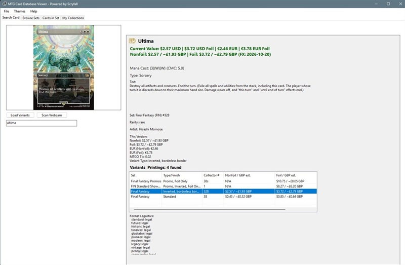
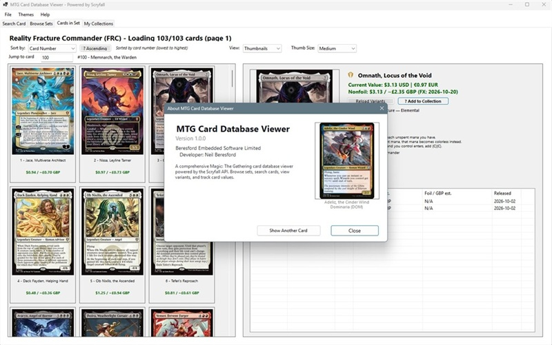
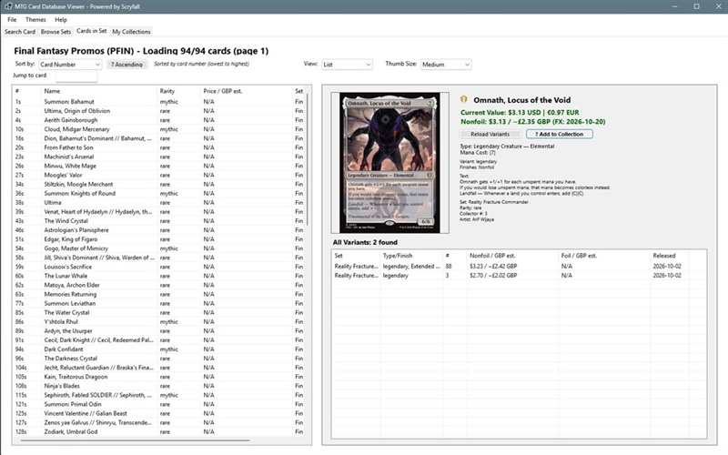
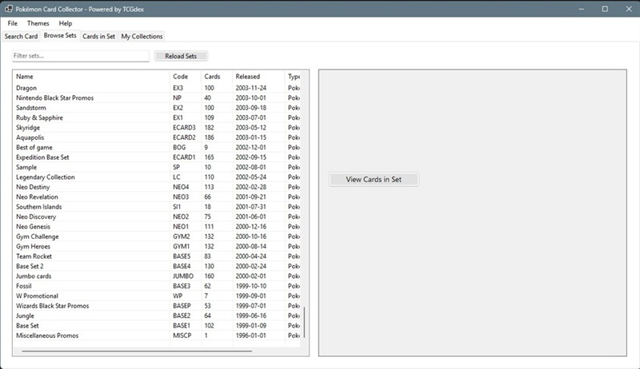
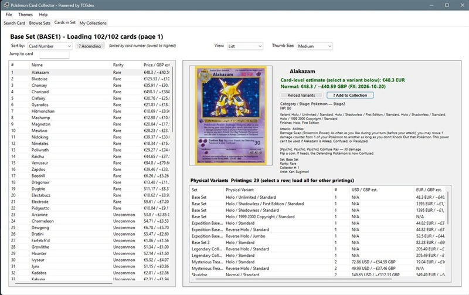
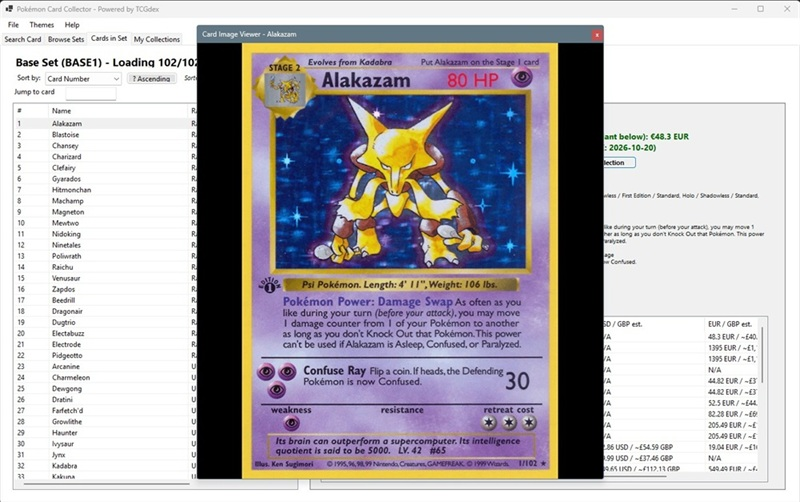

# Trading Card Collection Apps

This repository contains two Windows desktop applications for looking up trading cards and organizing personal collections:

- **MTG Card Database Viewer** — browse Magic: The Gathering cards, sets, printings, and prices using Scryfall.
- **Pokémon Card Collector** — browse Pokémon cards, sets, and physical card variants using TCGdex.

Both apps are built with Windows Forms on .NET 10. They share a familiar layout and collection-management workflow, but use different card data services and keep their collection files separate. They are intended as personal reference and organization tools; displayed prices are provider-supplied estimates, not guaranteed sale prices or financial advice.

## Contents

- [Applications and screenshots](#applications-and-screenshots)
- [Requirements and installation](#requirements-and-installation)
- [General use](#general-use)
- [Application-specific notes](#application-specific-notes)
- [Collection data, backups, and privacy](#collection-data-backups-and-privacy)
- [Troubleshooting](#troubleshooting)
- [Development guide](#development-guide)
- [Further documentation and data attribution](#further-documentation-and-data-attribution)

## Applications and screenshots

### MTG Card Database Viewer

The MTG app is for searching individual Magic cards, browsing sets, inspecting printings and finishes, and maintaining one or more personal collections. It supports card-image viewing and an optional webcam/OCR lookup workflow.

**Search a card and inspect its details**



**Browse cards in a set using the thumbnail view**



**Browse cards in a set using the list view**



### Pokémon Card Collector

The Pokémon app supports card-name lookup, set browsing, card images and details, physical printing variants, prices when supplied by the data provider, collection folders, and optional webcam/OCR lookup. Its variant records can distinguish finishes and available edition, subtype, stamp, and size information. Variant coverage depends on the provider's data.

**Browse Pokémon sets**



**Browse a set and inspect the selected card and physical variants**



**Open a card image for closer inspection**



## Requirements and installation

### Requirements

- Windows 10 or later.
- The **.NET 10 SDK** to build from source. Running a framework-dependent build requires the .NET 10 Desktop Runtime.
- Internet access for card/set data, card images, and available price or exchange-rate data.
- A webcam is optional; it is needed only for camera scanning.

### Run from Visual Studio

1. Open `ProjectTradingCardsCollection.slnx` in Visual Studio 2026, or open either project file directly.
2. Restore NuGet packages when prompted.
3. Select `ProjectMTGCollector` or `ProjectPokemonCollector` as the startup project.
4. Start debugging (F5) or run without debugging (Ctrl+F5).

### Build or run from PowerShell

Run these commands from the repository root:

```powershell
dotnet restore .\ProjectTradingCardsCollection.slnx
dotnet build .\ProjectTradingCardsCollection.slnx
```

Run one app at a time with:

```powershell
dotnet run --project .\ProjectMTGCollector\ProjectMTGCollector.csproj
```

or:

```powershell
dotnet run --project .\ProjectPokemonCollector\ProjectPokemonCollector.csproj
```

The executable and its build output are written under that project's `bin` directory. The Pokémon project includes `eng.traineddata` in its output for OCR. For a distributable build, use Visual Studio's publish workflow or `dotnet publish` for the desired project and target Windows runtime; test the published output on a clean machine before distributing it.

## General use

The apps provide four main tabs: **Search Card**, **Browse Sets**, **Cards in Set**, and **My Collections**. Some controls and variant details differ between the two apps.

### Find a card by name

1. Open **Search Card**.
2. Enter a card name and press **Enter** or select **Search**.
3. Review the card image and available details, such as set, collector number, rarity, type, rules text, artist, and price information.
4. Where available, select or load printings/variants to compare editions, finishes, or set releases. A double-click on a card image opens the larger image viewer.
5. Use **Add to Collection** to save the card to a collection folder (see [Manage collections](#manage-collections)).

If the service returns no matching card, check the spelling or try a simpler name. Search behavior is determined by the relevant data provider.

### Browse sets and their cards

1. Open **Browse Sets** and load or refresh the set list if it has not loaded yet.
2. Use the set filter to narrow the list by name or code. Select a set and choose **View Cards in Set**, or double-click the set where supported.
3. In **Cards in Set**, select a card from the list or thumbnail grid to see its details.
4. Use the sort controls to order the set by card number, name, rarity, or price where available. The MTG and Pokémon apps also provide a collector-number jump box and thumbnail sizing controls.
5. Load variants/printings for the selected card when you need to inspect other known versions. In the Pokémon app, use **Load All Variants** to request other exact-name printings where available.

Set and card data may take time to load, especially on the first request or when a set contains many cards. Subsequent requests may be faster because the apps cache data or images during use.

### Manage collections

1. Open **My Collections** and select **New Collection**. Enter a name and optional description.
2. Select the collection and create one or more folders (for example, by set, deck, storage box, or collecting goal).
3. Return to Search Card or Cards in Set, select a card, and choose **Add to Collection**.
4. In the dialog, select a folder, set the quantity, and provide any available variant, finish, condition, or notes information. A collection must have at least one folder before a card can be added.
5. In **My Collections**, select a collection and folder to review saved cards. Use the remove control when you want to remove a saved entry. Deleting a collection or folder removes its contents, so confirm carefully.

Adding an entry that matches an existing card/variant in the same folder may increase its quantity rather than creating a separate row. The app's matching details differ by game; see [Application-specific notes](#application-specific-notes).

### Optional webcam scanning

1. Connect and enable a webcam (a physical or supported virtual camera).
2. Choose **Scan Webcam** from the card-search screen and select the camera if prompted.
3. Hold a card steady in good, even lighting and follow the scanner's prompts. OCR-assisted recognition is intended to help find a card; verify the result before adding it to a collection.

Avoid glare, blur, and backgrounds that obscure the card. OCR and camera recognition can fail or identify the wrong card, so treat the result as a suggested lookup rather than confirmation. The OCR language data file `eng.traineddata` must remain available with the app; it is included in the Pokémon build output and in the MTG project.

### Preferences and menus

Use **Themes** or **Preferences** in the menu to select an available visual theme. The **Help > About** menu displays app information, and **File > Exit** closes the application.

## Application-specific notes

### MTG Card Database Viewer

- **Data source:** [Scryfall's public API](https://scryfall.com/docs/api). No API key is required by this app.
- **Card lookups:** Search uses Scryfall's fuzzy card-name lookup. Set browsing loads set details and card results; printing lookup can retrieve other printings of a card.
- **Printings:** The variant list describes available printings and finishes, including data such as set, collector number, foil/nonfoil prices, promo, frame, or border details when provided by Scryfall.
- **Prices:** Scryfall prices can be missing. USD/EUR and MTGO ticket prices are shown where present. GBP values are estimates calculated from available USD or EUR values using daily reference exchange rates; the rate date is displayed. They are not live UK-market quotes. Original prices remain available when exchange-rate data cannot be loaded.
- **Collection dialog:** Choose a folder, quantity, and foil status; condition and notes can also be recorded.
- **More guidance:** [MTG user guide](ProjectMTGCollector/docs/UserGuide.md), [Scryfall integration notes](ProjectMTGCollector/docs/ScryfallAPI.md), and [set notes](ProjectMTGCollector/docs/MTG_Sets.md).

### Pokémon Card Collector

- **Data source:** [TCGdex](https://tcgdex.dev/)'s public API. No API key is required by this app.
- **Sets and cards:** The app loads set summaries and retrieves full set/card details as needed. First-time set browsing can be slower because release dates and full card information are loaded from detail endpoints.
- **Physical variants:** A variant row can represent a specific printing/finish and distinguish details such as unlimited, shadowless, first edition, or stamped variants where TCGdex provides that data. A **First Edition** availability flag alone does not prove every combination exists; the app labels unspecified choices rather than inventing exact printings. Saved legacy entries may be identified as an unknown exact variant and are not automatically merged into a newly identified variant.
- **Prices:** Prices are shown only when TCGdex supplies them for the card or printing. USD/EUR values may come from TCGplayer or Cardmarket; GBP is an estimate using an exchange-rate feed. Missing variant prices remain unavailable rather than being borrowed from a different printing. Set lists and thumbnails may show card-level estimates; select a physical-variant row for variant-specific prices. None of these values are guaranteed sale prices.
- **Collection dialog:** Choose the physical variant, folder, quantity, condition, and optional notes before adding the card. Different exact variants are tracked separately.
- **OCR:** The English Tesseract data file `eng.traineddata` is copied to the build output.
- **More guidance:** [Pokémon app notes and data details](ProjectPokemonCollector/README.md).

## Collection data, backups, and privacy

Collections are saved locally as JSON, independently for each app:

- MTG: `%APPDATA%\MTGCollector\collections.json`
- Pokémon: `%APPDATA%\PokemonCollector\collections.json`

`%APPDATA%` resolves to the current Windows user's roaming application-data directory. The files store collection names, folders, card entries, quantities, and other saved collection fields. They are not shared between the apps and are not a cloud-sync or multi-user database.

To back up a collection, close its app and copy the corresponding `collections.json` file to a safe location. To restore it, close the app and restore the file to the same app-specific folder. Keep an additional backup before manually editing JSON; invalid edits can prevent the data from loading. Do not edit the same file while the app is running. The app may notice changes made by another process and reload them, but this is not a substitute for a backup.

The apps make network requests to their respective card-data services and image/price sources. Avoid placing sensitive personal information in collection names or notes.

## Troubleshooting

- **Build or startup failure:** Confirm Windows and the .NET 10 SDK/Desktop Runtime are installed, then restore packages and build the selected project again.
- **No results or missing details:** Check the internet connection, try a more exact card name, and remember that the data provider may not contain every card or field.
- **Slow first set load:** Some set lists require extra requests for release dates, card details, variants, prices, or images. Allow the load to finish before retrying.
- **Prices show N/A:** The provider may not supply a price for that card, currency, finish, or exact variant. GBP also depends on exchange-rate data. Missing values are not proof that a card has no market value.
- **Webcam unavailable:** Check Windows camera permissions, close other applications using the camera, and confirm the device or virtual camera is enabled.
- **OCR misses a name:** Improve lighting and focus, reduce glare, and verify the suggested result manually. Confirm `eng.traineddata` is present next to the built app if OCR initialization fails.
- **Collection changes are missing:** Make sure you are looking at the correct app's AppData file and that the correct collection/folder is selected. Restore a known-good backup if the JSON file was damaged.

## Development guide

### Repository layout

```text
ProjectTradingCardsCollection.slnx
ProjectMTGCollector/
  Forms/       Windows Forms UI and dialogs
  Models/      MTG card, set, collection, and display data models
  Services/    Scryfall, image cache, collection persistence, and prices
  Utils/       Shared UI/display helpers within the MTG project
  docs/        MTG user and technical documentation
ProjectPokemonCollector/
  Forms/       Pokémon Windows Forms UI and dialogs
  Models/      Pokémon card, set, variant, and collection models
  Services/    TCGdex, image cache, collection persistence, and prices
  Utils/       Shared UI/display helpers within the Pokémon project
Images/        Repository screenshots used by this README
```

The solution contains two separately buildable WinForms projects. Their similar screens do not imply that the card services or collection stores are interchangeable: preserve the separate data sources, game-specific card/variant models, and AppData paths unless a deliberate shared design is introduced.

### Build and launch during development

From the repository root, build the solution or an individual app:

```powershell
dotnet build .\ProjectTradingCardsCollection.slnx
dotnet build .\ProjectMTGCollector\ProjectMTGCollector.csproj
dotnet build .\ProjectPokemonCollector\ProjectPokemonCollector.csproj
```

Launch the project you are changing:

```powershell
dotnet run --project .\ProjectMTGCollector\ProjectMTGCollector.csproj
dotnet run --project .\ProjectPokemonCollector\ProjectPokemonCollector.csproj
```

For a normal development change, build the affected project; build the solution when changing shared conventions or both applications. Exercise the affected user flow manually against real API data as well as compiling, particularly for network loading, pagination, variant selection, image handling, and collection persistence.

### Where to make changes

- **UI and workflows:** Start in the appropriate app's `Forms` directory. Main screens are split into partial files; dialogs have their own form and designer files.
- **Card/set data:** Keep provider-specific HTTP requests, deserialization, caching, retry/rate-limit behavior, and mapping in that app's `Services` layer. Map provider responses into the relevant `Models` types before using them in UI code.
- **Collection behavior:** Update the app's `CollectionService` and collection models together when changing saved fields or matching rules. Preserve compatibility with existing JSON files or provide an explicit migration; never silently reinterpret a legacy entry as a different physical printing.
- **Pricing:** Keep source currency and price provenance clear. Do not present estimates or a converted currency as a guaranteed market quote. Preserve an unavailable state when the provider does not supply a value.
- **Images and OCR:** Reuse the existing image cache and scanner forms. If changing OCR resources, ensure the required language data is copied to build/publish output for both relevant projects.
- **Documentation and screenshots:** Update this root README when user-visible workflows or supported behavior changes. Update the app-specific guide when its detailed behavior changes. Keep image paths relative to the repository root and ensure screenshots do not expose personal collection data.

### Contributor checklist

1. Identify which app(s) the change affects and preserve the other app's behavior.
2. Respect the source service's public API usage guidance, request limits, attribution, and unavailable/error states.
3. Keep API, file, and price operations responsive and report errors clearly; do not convert failed lookups into misleading successful results.
4. Treat the collection JSON shape as persistent user data. Preserve existing entries and test add, update, remove, reload, and backup/restore behavior when changing it.
5. Build the affected project, run any relevant tests available in the solution, and manually verify the specific user workflow. Include edge cases such as missing images/prices, unavailable network, and legacy variant data where relevant.
6. Update relevant user documentation and add or refresh screenshots only when they help explain the change.

## Further documentation and data attribution

- [MTG user guide](ProjectMTGCollector/docs/UserGuide.md)
- [MTG Scryfall integration notes](ProjectMTGCollector/docs/ScryfallAPI.md)
- [MTG set notes](ProjectMTGCollector/docs/MTG_Sets.md)
- [Pokémon project notes](ProjectPokemonCollector/README.md)
- [Scryfall API documentation](https://scryfall.com/docs/api)
- [TCGdex API documentation](https://tcgdex.dev/)

Card information, images, and price data are provided by the respective third-party data services and may be incomplete or change over time. Follow each provider's current terms and API guidance when using or extending the apps. The repository screenshots illustrate the applications and are not card-data feeds.